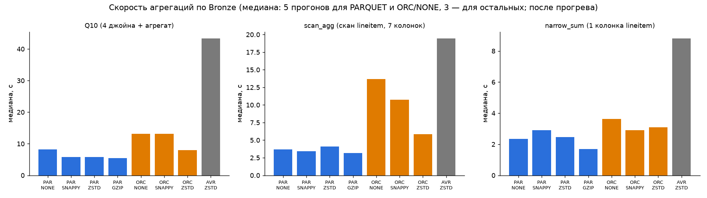

# Локальный Lakehouse: TPC-H Q10 «Returned Item Reporting»

Практическая работа №1. **Лавров Виктор**, вариант 2 (Q10), масштаб **sf10** (60 млн строк `lineitem`).

Стек: **Silo (S3, свободный форк MinIO) → Iceberg через Lakekeeper REST Catalog (метаданные в PostgreSQL) → Trino**,
BI — **Apache Superset**. Реализован полный цикл медальона Bronze → Silver → Gold поверх генератора TPC-H и проведён
бенчмарк форматов и кодеков.

📄 **Подробный отчёт с обоснованием каждого решения — [отчет.md](отчет.md).**

```
┌──────────┐ SQL ┌───────┐ REST: метаданные ┌────────────┐   ┌────────────┐
│ Superset │───► │ Trino │ ───────────────► │ Lakekeeper │──►│ PostgreSQL │
└──────────┘     └───┬───┘                  └────────────┘   └────────────┘
                     │ читает/пишет parquet + metadata.json
                     ▼
               ┌────────────┐   bucket warehouse/
               │ Silo (S3)  │   ├── bronze: nation, region, customer, orders, lineitem
               └────────────┘   ├── silver: customer, order_lines (partition month(orderdate))
                                └── gold:   q10_returned_items_top20, returns_by_nation_quarter
```

## Методология

**1. Lakehouse.** Четыре контейнера (`scripts/up.sh`): Silo — S3-хранилище файлов; PostgreSQL — БД каталога;
Lakekeeper — Iceberg REST Catalog (хранит, какие файлы и снапшоты составляют таблицу); Trino — SQL-движок с каталогами
`lakekeeper` (Iceberg), `tpch` (детерминированный генератор TPC-H) и `blackhole` (baseline для бенчмарка).

**2. Полный цикл данных (медальон).**

| Слой | Что делает | Таблицы | Хранение |
|---|---|---|---|
| **Bronze** — загрузка сырых данных | копия `tpch.sf10` «как есть»: все колонки, исходные типы + техколонки `_ingested_at`, `_source`; сверка числа строк с источником | `customer`, `orders`, `lineitem`, `nation`, `region` | PARQUET + ZSTD, без партиций |
| **Silver** — очистка, нормализация, обогащение | `trim`, фильтр невалидных строк, дедупликация; деньги `double → decimal`; клиент + страна + регион; факт `orders ⋈ lineitem` с `net_revenue` и `is_returned` | `customer`, `order_lines` | PARQUET + ZSTD, `order_lines` партиционирован по `month(orderdate)` |
| **Gold** — агрегаты для бизнес-аналитики | ответ на Q10 (топ-20 клиентов по возвратам за 1993-Q4) + агрегат возвратов по странам и кварталам для BI | `q10_returned_items_top20`, `returns_by_nation_quarter` | PARQUET + ZSTD, один файл |

Корректность: `sql/04_validate.sql` проверяет отсутствие дублей и «сирот» в Silver и сверяет Gold с исходным Q10,
дословно (заменён только `sf1 → sf10`) и выполненным прямо по генератору: **все 20 строк совпали по всем 8 колонкам** (у 4 клиентов текст отличается только крайними пробелами, убранными `trim` в Silver), расхождение выручки 2·10⁻¹⁰.

**3. Бенчмарк форматов и кодеков** (`scripts/benchmark.py`). Bronze целиком пересоздаётся для каждой комбинации:
PARQUET × {NONE, SNAPPY, ZSTD, GZIP}, ORC × {NONE, SNAPPY, ZSTD}, AVRO × {ZSTD} (8 конфигураций; LZ4 Trino не поддерживает;
ORC+LZ4/GZIP и остальные AVRO не прогонялись ради времени — см. отчёт §5). Для каждой измеряется:
- **размер файлов** — сумма `file_size_in_bytes` из метаданных Iceberg (`"<таблица>$files"`);
- **время записи** — `elapsedTime` CTAS из статистики Trino минус стоимость генерации данных (та же генерация в `blackhole`, ~11 с);
- **скорость агрегаций** — 3 запроса: Q10 (4 джойна + агрегат), полный скан-агрегат `lineitem` (7 колонок), агрегат по 1 колонке.
  Прогрев + 3–5 замеров, медиана; дополнительно CPU и байты, реально прочитанные из S3.

## Ключевые результаты

| Формат | Кодек | Bronze, МБ | Запись, с | Q10, с | Прочитано Q10, МБ |
|---|---|---:|---:|---:|---:|
| PARQUET | NONE | 5 285 | 74.1 | 8.19 | 1 481 |
| PARQUET | SNAPPY | 2 800 | 41.7 | 5.86 | 777 |
| **PARQUET** | **ZSTD** | **2 037** | **67.7** | **5.76** | **495** |
| PARQUET | GZIP | 1 989 | 105.5 | 5.45 | 498 |
| ORC | NONE | 6 301 | 94.8 | 13.09 | 1 440 |
| ORC | SNAPPY | 2 891 | 223.4 | 13.14 | 762 |
| ORC | ZSTD | 2 092 | 133.6 | 8.02 | 553 |
| AVRO | ZSTD | 3 897 | 150.3 | 43.29 | 2 591 |
| PARQUET/AVRO | LZ4 | не поддерживается Trino 476 | | | |



- **Формат важнее кодека**: колоночный Parquet читает для Q10 в 5 раз меньше данных, чем строковый AVRO, и выполняет запрос в 7.5 раз быстрее; в Trino Parquet быстрее ORC и на записи, и на чтении.
- **Сжатие ускоряет запросы**: данных в 2.6 раза меньше, а узкое место — чтение из S3, а не распаковка.
- **Выбран PARQUET + ZSTD**: размер на уровне GZIP (+2.4%), запись в 1.6 раза быстрее GZIP, запросы так же быстры.
- **Модель данных важнее всего**: Q10 по Bronze — 3.8 с, по партиционированному Silver — 0.78 с (читает 100 МБ вместо 495), по Gold — 22 мс.

Часть 2: schema evolution (ADD/RENAME COLUMN на Silver) и восстановление из снапшота — `scripts/evolution_timetravel.py`;
Superset, подключённый к Bronze через Trino — `scripts/superset.sh`. Подробности в [отчет.md](отчет.md) §6.

## Структура

| Путь | Что внутри |
|---|---|
| `scripts/up.sh` | подъём стека (`docker run` для Silo, Postgres, Lakekeeper, Trino) |
| `catalog/` | каталоги Trino: `lakekeeper`, `tpch`, `blackhole` |
| `create-warehouse.json` | регистрация warehouse `demo` → бакет `warehouse` в Lakekeeper |
| `sql/01_bronze.sql` · `02_silver.sql` · `03_gold.sql` | слои медальона |
| `sql/04_validate.sql` | проверки качества Silver и сверка Gold с эталонным Q10 |
| `scripts/run_pipeline.sh` | прогон всего медальона |
| `scripts/trino.py` | мини-клиент Trino REST API (только стандартная библиотека Python) |
| `scripts/benchmark.py` | бенчмарк форматов и кодеков |
| `scripts/q10_timing.py` | время Q10 на каждом слое |
| `scripts/evolution_timetravel.py` | schema evolution и time travel на Silver |
| `scripts/layer_stats.py` · `scripts/charts.py` | статистика слоёв, сводные таблицы и графики |
| `scripts/superset.sh`, `superset/` | развёртывание Superset с драйвером Trino |
| `results/` | сырые замеры (CSV) и логи прогонов |
| `img/` | графики бенчмарка и скриншот Superset |

## Как воспроизвести

Нужны Docker Desktop (≥ 8 ГБ RAM) и Python 3. Команды выполнять из корня репозитория.

```bash
./scripts/up.sh
```

```bash
./scripts/run_pipeline.sh
```

```bash
python3 scripts/benchmark.py
```

```bash
python3 scripts/q10_timing.py && python3 scripts/evolution_timetravel.py && python3 scripts/layer_stats.py
```

```bash
python3 -m venv .venv && .venv/bin/pip install matplotlib && .venv/bin/python scripts/charts.py
```

```bash
./scripts/superset.sh
```

Адреса: Trino — http://localhost:8080, консоль Silo/MinIO — http://localhost:9001 (`minioadmin`/`minioadmin`),
Lakekeeper — http://localhost:8181, Superset — http://localhost:8088 (`admin`/`admin`). Все пароли демо, только для локального стенда.
